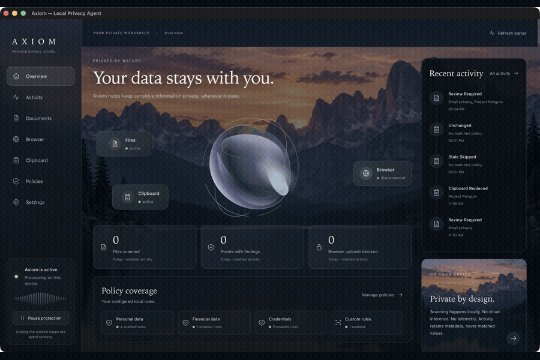
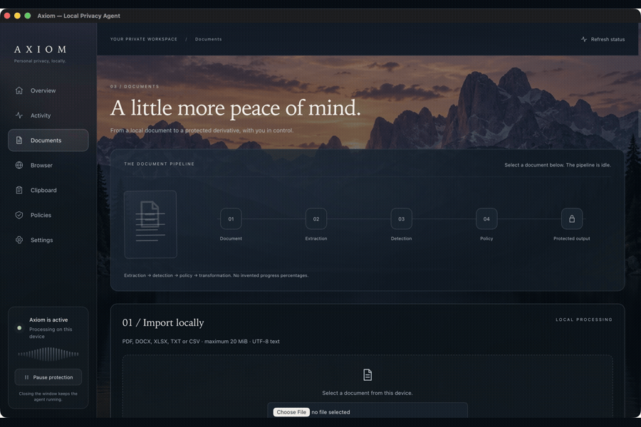
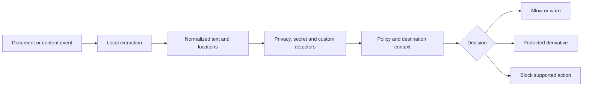

<div align="center">

# A X I O M

### Your data stays with you.

A local privacy agent for macOS.<br />Inspect documents, apply privacy policies, and protect supported clipboard and browser workflows.

**React · Tauri · Python · Chrome MV3**

[](docs/RELEASE.md)
[](docs/RELEASE.md)
[](https://github.com/Shrithan/Axiom/actions/workflows/verify.yml)

[Get started](#get-started) · [Features](#what-it-does) · [Try a policy](#try-a-policy) · [Browser setup](browser-extension/README.md) · [Architecture](#how-it-works) · [Limitations](#know-the-boundary)


</div>

> **Experimental prototype.** Axiom enforces specific local workflows; it is not universal or tamper-resistant enterprise DLP. The employee app is functional. The admin app is a disconnected prototype.

## A quieter place to manage privacy

Seven continuous chapters—Overview, Activity, Documents, Browser, Clipboard, Policies and Settings—keep your work in one place. Your document selection, results, filters and rule drafts survive navigation. Motion pauses offscreen and respects reduced-motion preferences.



*GIF tour assembled from native app screenshots. It shows the interface, not a recording of live enforcement or scroll animation.*

## What it does

| Surface | Available today |
| --- | --- |
| Documents | Extract supported text from PDF, DOCX, XLSX, TXT and CSV; show findings and policy explanations. |
| Policies | Configure built-in categories, literal keywords and bounded regex rules with ALLOW, WARN, REDACT or BLOCK. |
| Protected export | Re-evaluate current policies before creating a protected TXT/CSV derivative; preserve the original. |
| Clipboard | Monitor text changes and apply version-checked replacement or clearing on macOS. |
| Selected folders | Observe file events and assess supported documents in explicitly selected folders. |
| Chrome | Opt-in enforcement for supported standard POST multipart upload forms through Native Messaging. |
| Gmail stopgap | Conservative guard withholds **all file drops**; selective scanning, paperclip, Drive and Send are unsupported. |
| Activity | Bounded metadata history and real source/connection status, with local review where references remain available. |

Sensitive content is processed locally. The active employee workflow uses no cloud inference, Firebase synchronization, telemetry or external font loading. Installing dependencies requires network access; document processing does not.

## Get started

**Requirements:** macOS, Node.js 22.12+, Python 3.10+, Rust stable and Xcode Command Line Tools. Python and parser dependencies are currently external prerequisites.

```sh
git clone https://github.com/Shrithan/Axiom.git
cd Axiom

python3 -m venv .venv
.venv/bin/python -m pip install -r axiom-employee/scripts/requirements.txt
npm ci --prefix axiom-employee
npm ci --prefix axiom-admin

AXIOM_PYTHON="$PWD/.venv/bin/python" npm --prefix axiom-employee run tauri dev
```

Open **Documents** to import and scan a file. Use **Policies** to edit local rules. Enable background sources and choose folders in **Settings**. No folder is selected by default. Closing the window leaves the agent running; **Quit Axiom** stops it.

<details>
<summary>Manual scanner in your browser</summary>

From the repository root:

```sh
npm --prefix axiom-employee run build
.venv/bin/python axiom-employee/scripts/local_server.py
```

Open **http://127.0.0.1:8765**. This loopback development server supports manual scanning only. Desktop monitoring and Chrome enforcement require the native app. Do not expose or proxy the server to a network. `npm run dev` alone does not start the Python backend.

</details>

<details>
<summary>Build and run the macOS app</summary>

```sh
npm --prefix axiom-employee run tauri -- build --bundles app
AXIOM_PYTHON="$PWD/.venv/bin/python" \
  ./axiom-employee/src-tauri/target/release/bundle/macos/Axiom.app/Contents/MacOS/axiom
```

This produces an unsigned development app. It is not a standalone installer: keep Python and its parser libraries installed. Set `AXIOM_PYTHON` when launching if automatic interpreter discovery cannot find your environment.

</details>

## Try a policy

1. In **Policies**, create an enabled Keyword rule for `Penguin`, case insensitive, action **REDACT** and transformation **REDACT**.
2. Import `axiom-employee/examples/project-penguin.txt` in **Documents** and scan it.
3. Inspect the findings and protected preview. Matched values stay concealed until explicitly revealed locally.
4. Export to a new file. Confirm the original is unchanged.
5. Set the rule to **BLOCK** and scan again: protected output must be withheld.

```text
Project ███████ launches on November 3.
Contact ████████████████ for details.
```



*Screenshot sequence of the document interface and comparison view. Use fictional files for your own tests.*

For PDF testing, use a text-based PDF. Image-only PDFs require OCR, which is not implemented. Protected derivatives contain extracted text; Axiom does not produce layout-preserving sanitized PDFs.

### Connect Chrome

```sh
npm --prefix browser-extension run build
python3 browser-extension/native/install.py
```

Keep the native agent running. Load `browser-extension/dist` unpacked at `chrome://extensions`, open the extension toolbar popup, opt into the site and reload the page. The popup must report connection to the local agent. Both processes must use the same data directory.

Follow the [complete extension setup and receipt harness](browser-extension/README.md) before relying on browser protection. Arbitrary AJAX uploads, redirects and general drag-and-drop are outside the standard form boundary. Actual Gmail drop-path verification is still outstanding.

## How it works



**BLOCK > REDACT > WARN > ALLOW.** Detection and enforcement are separate: a filesystem BLOCK result does not stop another application from sending the original. Exports re-extract original input and apply current policies rather than trusting client preview text.

Local settings, policies and metadata audit records default to `~/.axiom-local`; `AXIOM_DATA_DIR` overrides this. Scanning does not persist original content, matched values, filenames or paths in the audit. Policy patterns themselves can contain private organizational information.

## Verification

```sh
.venv/bin/python scripts/verify.py          # Python, extension, UI and frontend builds
.venv/bin/python scripts/verify.py --native # Also Rust tests and macOS release build
```

**Latest local verification: 197 tests passed**, both frontend builds passed, and the macOS release app built successfully. Both Python suites also passed from a clean source archive. CI repeats verification on macOS; the badge reflects GitHub's actual run status.

| Suite | Passing tests |
| --- | ---: |
| Employee Python | 109 |
| Native-host Python | 7 |
| Extension JavaScript | 27 |
| Frontend UI | 18 |
| Rust | 36 |

See [release verification and use-case tests](docs/RELEASE.md), [native UI evidence](docs/immersive/README.md) and [historical browser receipt evidence](docs/phase3/receipts.json).

## Know the boundary

- **Not universal interception:** unsupported upload paths, other apps' original-file exports, printing, screenshots and screen sharing are not blocked.
- **No OCR or full-package sanitization:** image text, embedded objects and other unsupported document surfaces can escape extraction. A clean scan does not certify safety.
- **Clipboard polling has a race window:** it cannot prevent every paste.
- **Local configuration is editable:** no signed organization policies, anti-tamper enforcement, authentication or central control plane.
- **Gmail is limited:** its guard blocks all file drops; it does not selectively assess attachments or protect paperclip, Drive or Send.
- **Remaining validation:** live Gmail behavior, latest Chrome navigation, fresh-machine installation and hardware animation profiling have not been verified.

For **“file unavailable”**, import the original in Documents: activity review references are bounded and can expire or disappear after restart. For **“malformed PDF”**, verify the selected interpreter has parser dependencies, then try a known text PDF. See [troubleshooting](docs/RELEASE.md#troubleshooting).

## Explore the repo

```text
axiom-employee/    React employee UI, Tauri agent, Python engine and tests
axiom-admin/       Disconnected admin interface prototype
browser-extension/ Chrome MV3 form gate, native host and receipt harness
docs/              Architecture, screenshots, evidence and release guide
scripts/           Repeatable verification and clean source packaging
```

[Technical reference](docs/TECHNICAL.md) · [Background agent](docs/PHASE2.md) · [Browser architecture](docs/PHASE3.md) · [Contributing](CONTRIBUTING.md) · [Security reporting](SECURITY.md)

**License:** not yet selected by the owner. Public visibility does not grant a reuse license; confirm redistribution rights for artwork and other assets before redistributing.
