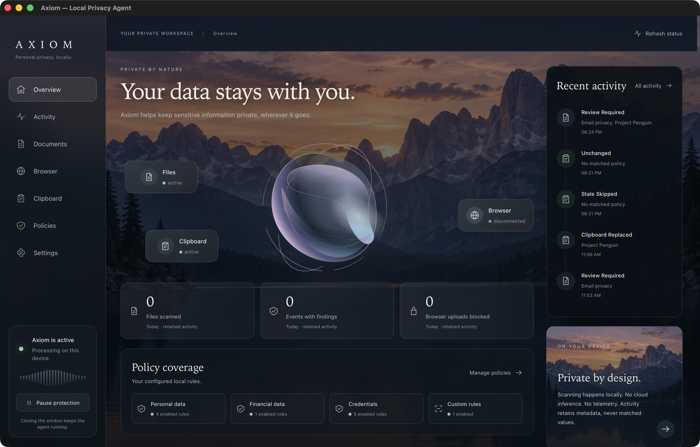

# Axiom Local Privacy Boundary Agent

**Experimental macOS prototype · not production DLP.** [Quick start, use-case tests and release limitations](RELEASE.md) · [UI screenshots](immersive/README.md) · [Security](../SECURITY.md)



**Sensitive content is processed locally and is not sent to external inference services.**

Axiom Employee now runs a macOS background agent around its existing local document pipeline. It observes selected-folder file events and text clipboard changes, enforces clipboard redaction/clearing, and exposes real activity and source health. An opt-in Chrome extension now enforces local, destination-aware decisions for standard multipart file-upload forms. The admin application remains a disconnected prototype. There is no Firebase synchronization, cloud inference, telemetry, or external font loading in the active employee workflow.

## Phase 2 background protection

The native app provides Dashboard, Activity, Documents, Local Rules, Settings, selected-folder monitoring, clipboard protection, pause/resume and explicit Quit. Closing the main window leaves protection running. No folders are selected by default; notifications are opt-in. The employee HTTP development UI continues to support manual scanning only; browser enforcement requires the native app and extension.

See [Phase 2 architecture, demonstration, action semantics and verification](PHASE2.md). Clipboard polling cannot stop every paste, and file BLOCK decisions do not block another application’s send/upload. Email/print/screen-share interception and login autostart are not implemented. Browser form enforcement is documented below.

## Phase 3 browser boundary

The macOS MV3 Chrome extension holds selected file bytes, classifies the actual initial form destination, invokes the existing local engine through Native Messaging, and controls standard HTML POST multipart uploads. Real Chrome/server tests verified EXTERNAL Project Penguin BLOCK with no receipt and INTERNAL ALLOW with an exact original hash, plus WARN consent and protected TXT delivery. It does not cover arbitrary AJAX, general drag-and-drop, redirects or universal browser egress. A separate conservative Gmail guard withholds all file drops; paperclip/Drive attachments and sending remain unsupported.

See [extension setup and reproducible local demo](../browser-extension/README.md), [Phase 3 architecture and limitations](PHASE3.md), and [actual receipt evidence](phase3/receipts.json). Native Settings includes connection status and INTERNAL/PARTNER/PUBLIC domain lists; unlisted domains default to EXTERNAL. No site access is granted automatically. REDACT supports small TXT derivatives with consent; other formats requiring redaction remain withheld for review.

## Run locally

Requirements: Node.js 20.19+ or 22.12+, Python 3.10+, and the local Python dependencies below. Rust and platform Tauri prerequisites are needed only for the desktop app. Dependency installation downloads software; runtime document processing requires no internet connection.

```sh
cd axiom-employee
python3 -m venv .venv
.venv/bin/python -m pip install -r scripts/requirements.txt
npm install
npm run build
.venv/bin/python scripts/local_server.py
```

Open `http://127.0.0.1:8765`. The server binds only to IPv4 loopback, serves the built frontend, and accepts same-origin requests with a per-process token. Do not expose or proxy this development server to a network. `npm run dev` alone serves the UI without a Python backend; use the local server or Tauri to scan documents.

For the desktop app, from `axiom-employee`:

```sh
AXIOM_PYTHON="$PWD/.venv/bin/python" npm run tauri dev
```

Build a native executable with `npm run tauri -- build --debug --no-bundle`, or a macOS development app with `npm run tauri -- build --debug --bundles app`. Scripts are bundled as resources; Python and its parser libraries remain prerequisites and are **not** included in the app. This is not yet a standalone enterprise installer. The native app honors `AXIOM_PYTHON`, then checks the repository `.venv` and standard macOS Homebrew Python locations before falling back to PATH. The selected interpreter must have `scripts/requirements.txt` installed. Missing parser dependencies are reported separately from malformed documents.

## Demonstrate Project Penguin

1. Open **Local rules** in the employee app.
2. Create a rule named `Project Penguin`, choose **Keyword**, enter `penguin`, leave case sensitivity off, and set severity **HIGH**, action **REDACT**, transformation **REDACT**, enabled **Yes**. Save it.
3. Open **Document scanner**, import `examples/project-penguin.txt`, and scan it. The built-in Email privacy policy defaults to REDACT with the MASK transformation.
4. Review the real detections, locations, matching rule, severity and intended action. Matched values are concealed until **Reveal locally** is expanded.
5. Preview and export the protected derivative:

```text
Project ███████ launches on November 3.
Contact ████████████████ for details.
```

The example is ordinary fixture text, not a special case in the detector. Rule edits, enable/disable controls and deletes persist locally and affect subsequent scans. Keyword rules match literal substrings; regex rules match independently with case sensitivity and execution limits.

## Implemented

- Local extraction of PDF text (page), DOCX body paragraphs/tables/headers/footers (paragraph or table cell), XLSX string/numeric/formula source values (sheet/cell), UTF-8 TXT (character offsets), and UTF-8 comma-separated CSV (row/column).
- Normalized `Document` and `Section` records; detectors do not parse file formats.
- Pluggable privacy, secret and organization detectors. SSN component validation, Luhn validation for payment-card candidates, North American phone structure checks, email matching, validated IPv4 candidates, common API key formats, private key blocks, identifiable bearer tokens, credential URLs and credential assignments.
- Configurable keyword, case-insensitive keyword, regex and built-in category policies; no administrator code execution. Regex evaluation uses the local `regex` library with a 50 ms operation timeout, a 10 second detector budget, rule count/pattern limits and rejection of empty-matching patterns.
- Separate policy evaluation with ALLOW, WARN, REDACT and BLOCK; transformations REDACT, MASK, REMOVE and REPLACE. MASK retains only the last four digits for SSN/card/phone and fully conceals emails/general terms. These masks are policy choices, not guarantees of anonymization.
- Employee findings, policy explanations, protected text preview, explicit blocked-output state, local policy editor and metadata-only audit viewer. WARN permits output with a warning; it does not require approval.
- UTF-8 TXT protected derivatives for TXT/PDF/DOCX/XLSX; CSV export preserves rows and columns and neutralizes formula-leading cells. Desktop saves through a native dialog, rejects existing destinations, and never overwrites originals. Browser export requests a download; browser download behavior depends on the host browser.
- Export re-extracts the original in-memory file and evaluates **current** policies with `EXPORT` context. A caller cannot bypass blocking by providing modified preview text or fake decisions.
- Content events OPEN, COPY, PASTE, ATTACH, UPLOAD, EXPORT, PRINT, SEND and SCREEN_SHARE, and destinations INTERNAL, PARTNER, EXTERNAL and PUBLIC. V1 supplies them manually. The context model also carries source application, domain, file type, user and device fields; event/destination conditions are enforced now, other fields are extension points.
- Private local JSON policy storage and bounded JSONL audit storage. By default these live in `~/.axiom-local`, configurable with `AXIOM_DATA_DIR`. Policies contain administrator-defined patterns; audit stores timestamp, rule ID, action, severity, document type and event only. Matches, filenames, paths and original content are never persisted by scanning.
- Bounded files (20 MiB), extracted text (2M characters), sections (50K), PDF pages (1K), Office decompression (80 MiB), streaming rejection of XML DTD/entities and excessive complexity, regex execution and worker lifetime (30 seconds). Malformed, encrypted or image-only documents fail explicitly instead of displaying fabricated results.

## Architecture

```text
Document input / ContentEvent
    ↓
Local extractor (extraction.py)
    ↓
Normalized Document → Sections + locations
    ↓
Pluggable detectors (detectors.py / Detector protocol)
    ↓
Detections: type, original offsets, source, confidence, severity
    ↓
Policy engine (policy.py) + event/destination context
    ↓
Decisions: rule + action + transformation
    ↓
ALLOW / WARN / Transformation / BLOCK
    ↓
Protected preview or policy-enforced derivative export
```

`Pipeline.process(document, context)` is the common pipeline used by current clipboard/browser adapters and future email or local model adapters. `Pipeline.scan` adds extraction; `Service.handle` supplies the desktop IPC and local HTTP boundaries. A detector can implement the `Detector` protocol and be supplied via `extra_detectors`; it must return source offsets for transformations. No models are downloaded or loaded at runtime in V1.

**Precedence:** BLOCK > REDACT > WARN > ALLOW. Applicable policies for each detection are sorted by action rank, then lexicographically by rule ID for deterministic equal-rank ties. Any BLOCK withholds the entire protected output. Overlapping REDACT spans are merged and conservatively fully concealed, even when one requests MASK/REPLACE; overlapping rules cannot accidentally restore sensitive characters. Non-overlapping transformations operate once on original offsets, right to left. Severity affects reporting, not action precedence. Disabled custom rules produce no custom matches; disabled built-in policies leave detections visible with ALLOW unless another policy applies. Explicit ALLOW does not override stronger policies.

Confidence values are deterministic detector heuristics, not calibrated ML probabilities. Detection itself is not a policy decision, and a clean scan does not certify a document free of sensitive data.

## Limitations and planned work

Axiom enforces its own derivative exports, version-checked clipboard replacement/clearing and the supported opt-in Chrome upload forms. It cannot prevent exporting the original from another app, and local employees can edit the local policy file. It is a demonstrable local engine, not a tamper-resistant enterprise DLP product.

The supported extractors cover their stated text surfaces. Embedded media/objects, DOCX tracked revisions/text boxes/nested structures, package metadata, XLSX comments/charts/cached formula results, and PDF annotations/image text are not comprehensively scanned. Protected derivatives include only extracted text; they exclude the original package and unextracted surfaces. Native-format sanitization that preserves layout is deferred because it requires exhaustive coverage and verification that hidden content is removed. PDF coordinates, OCR, local semantic models, tokenization/pseudonymization, more regional detectors, separator detection for CSV/TSV, and legacy Office formats are planned.

Selected-folder filesystem events and text clipboard changes are implemented on macOS. Destination attribution is implemented for the initial form target in supported Chrome uploads. Arbitrary custom uploads, redirects, email integrations, screenshots, recording/screen-share interception, printing enforcement, login autostart, authentication, signed organization policy distribution, enterprise provisioning and a central control plane remain deferred. The original admin UI is retained as a prototype, with its disconnected status explicit. **The employee Local Rules page is the functional V1 configuration interface.** Old admin rule fixtures are not active employee policies. Cloud upload adapters are retired and contain no credentials. Previously embedded authentication credentials should be rotated outside this repository.

Recommended next phase: ship a reproducible bundled Python runtime, isolate parsers more strongly, expand extraction coverage and verified native-format export, then expand the proved browser boundary to custom upload paths and redirects. Signed policies and tamper protection should precede enterprise deployment.

## Verification and change map

```sh
cd axiom-employee
.venv/bin/python -m unittest discover -s tests -v
npm run build
cargo test --manifest-path src-tauri/Cargo.toml --lib
cargo check --manifest-path src-tauri/Cargo.toml
npm run tauri -- build --debug --no-bundle
cd ../axiom-admin
npm install
npm run build
cargo check --manifest-path src-tauri/Cargo.toml
```

The current suite passes **197 tests: 109 employee Python, 36 Rust, seven native-host Python, 27 extension JS and 18 frontend UI tests**, preserving the original Phase 1/2 tests. See `docs/PHASE3.md` for the real browser/server verification and new coverage. Native Rust tests include a real FSEvents event and require normal OS access outside a restrictive command sandbox. The original 43 tests cover built-in validation/false positives, secrets, literal keywords/case/regex, timeout failures, enabled/disabled rules, context, precedence/ties, overlapping and multiple matches, all transformations, all five extractors, malformed documents, archives/macros, all-format Penguin integration, export-time policy changes, CSV safety, local persistence, audit minimization, no-network operation, IPC output and HTTP request restrictions. Browser verification covers creating a Penguin rule, real file import, findings and preview. Native verification also covers saving and reading back `examples/project-penguin.protected.txt`. See `docs/IMPLEMENTATION.md` for the audit and verification record.

Added: `axiom-employee/scripts/axiom_agent/` (models, extraction, detectors, policy, transformation, pipeline, storage, service), `agent_ipc.py`, `local_server.py`, parser requirements, `src/agent/` (typed client, rule editor and styles), tests, example and implementation notes.

Modified: employee `App.tsx`/`App.css`, Tauri bridge/config/capabilities/Cargo manifest and locks, frontend package/locks/title; legacy entry points and both cloud adapters; admin error handling, disconnected-rule reporting, fonts and compatible package versions; repository ignores and READMEs. Original unused model/WASM assets are preserved under `legacy-model-assets` outside the frontend's public directory.

The original workspace arrived without Git metadata. Release preparation later restored the existing GitHub main history; see [release notes](RELEASE.md).

The continuous-scroll interface and section motion are documented in [Immersive UI verification](immersive/README.md). Run frontend regression checks with `npm --prefix axiom-employee run test:ui`.
